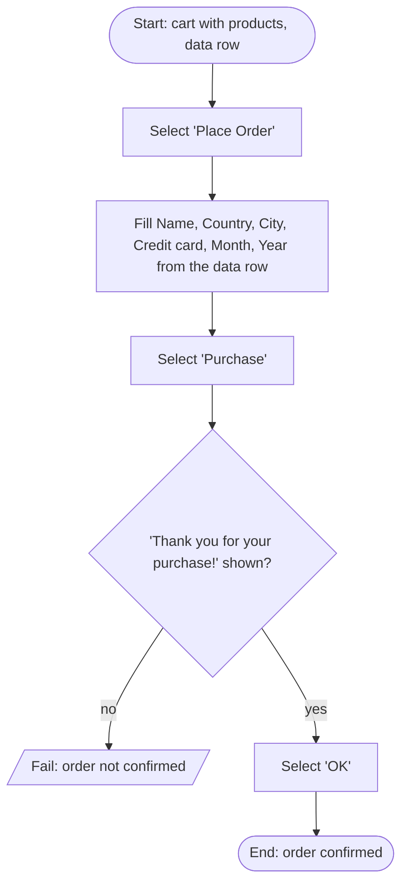

# TC-04 — Purchase form and confirmation (data-driven)

Requirements: PUR-04, PUR-05 · Plan: [demoblaze-purchase.md](../../plans/demoblaze-purchase.md) · Code: `RegisterCustomer`, `WaitForModal`, `Customer` · Data: feature Examples / `data/purchase/dataDemoblaze.xlsx`

