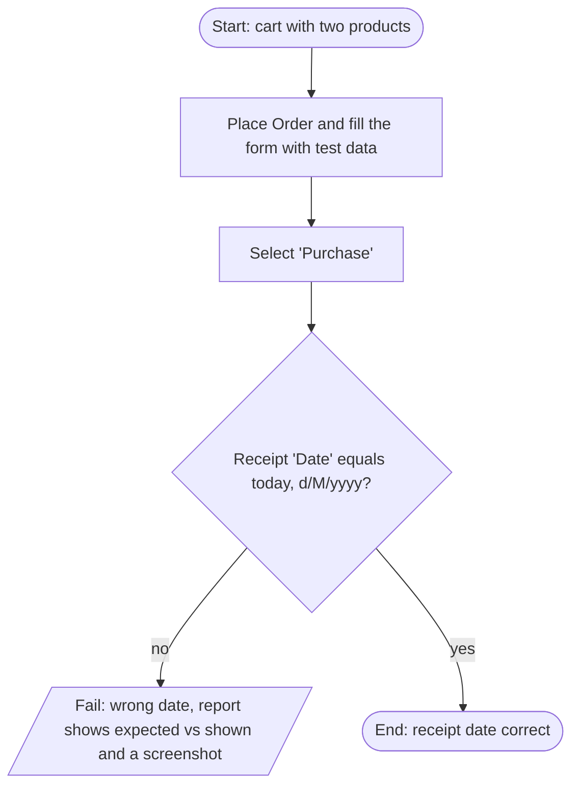

# TC-06 — Receipt shows the purchase date (known bug BUG-001)

Requirements: PUR-05 · Plan: [demoblaze-purchase.md](../../plans/demoblaze-purchase.md) · Code: `PurchaseReceipt`, step "the purchase receipt shows today's date"

Observed on 14/11/2026 (Chrome 1920x1080): the receipt showed `Date: 14/10/2026`, one month earlier. The scenario is tagged `@bug @BUG-001`: it is excluded from the regular run and checked on request with `gradlew test -Ptags="@bug"`; it fails until the fix and CI reports it as a known bug, not as a regression.

